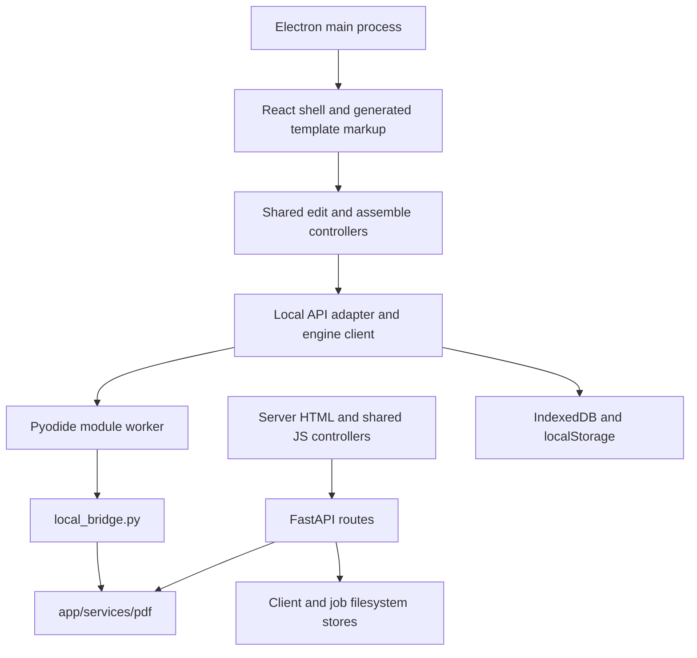

# Architecture

[Documentation index](README.md)

## Components and edition boundaries

APDF has one Python PDF service implementation and shared browser controllers. The server edition uses FastAPI and Jinja templates. The offline editions use a React shell around generated template markup and the same controllers; Python runs in a bundled Pyodide worker.

This diagram shows code reuse across builds, not a runtime HTTP connection from the offline app to FastAPI. The local API adapter recognizes API-shaped paths in memory; it does not send those calls to a server.

## Repository map

| Location | Responsibility |
| --- | --- |
| [app/main.py](../app/main.py) | FastAPI creation, route registration, cleanup and access-log middleware; server version. |
| [app/config.py](../app/config.py), [app/web.py](../app/web.py) | Environment configuration and shared Jinja context. |
| [app/routes](../app/routes/) | Sources, composition, editing, result pages, and downloads. |
| [app/services/pdf](../app/services/pdf/) | PDF reading, assembly, operations, vector overlays, paint and brush geometry. |
| [app/services/pdf_ops.py](../app/services/pdf_ops.py) | Compatibility facade for route imports. |
| [app/services/client_store.py](../app/services/client_store.py), [job_store.py](../app/services/job_store.py) | JSON metadata and PDF files; no database server. |
| [app/templates](../app/templates/) | Server templates and partials reused at local build time. |
| [app/static/js](../app/static/js/) | Shared browser controllers, preview, geometry selection, drawing and storage helpers. |
| [app/static/css](../app/static/css/) | Tokens, components, layout and responsive styles. |
| [local-app/src](../local-app/src/) | React shell, worker client, worker, local persistence and API adapter. |
| [local-app/engine/bridge.py](../local-app/engine/bridge.py) | Worker-local filesystem interface to the Python services. |
| [local-app/scripts](../local-app/scripts/) | Vendor preparation, template generation, offline cache, static server and web ZIP. |
| [desktop](../desktop/) | Electron main process, custom protocol, staging and native packaging. |
| [tests](../tests/), [local-app/tests](../local-app/tests/), [desktop/tests](../desktop/tests/) | Engine, server, browser, offline and native integration coverage. |
| [tools](../tools/) | HTTP smoke checks and favicon/native-icon generation. |

## Server request flows

### Assemble

1. Uploads are staged, parsed, and counted. A batch is published only after every file validates; failures remove the new staged files and keep previous sources.
2. `/compose` validates its JSON plan and source references.
3. The server setting selects `compose_direct` or `compose_with_result_code`. PDF work is dispatched to the thread pool.
4. Direct mode returns a temporary `FileResponse`; background cleanup removes the output after transfer. It creates no result job or code.
5. Code mode creates a filesystem job, builds synchronously, marks it done, and returns a JSON result-page URL. It never automatically changes mode because of size.

### Edit

`/edit/apply` stages the current PDF and required multipart attachments, validates operations, executes them sequentially, and writes `edited.pdf` under a job. Its JSON response always supplies a download URL. The browser fetches that PDF and commits an Undo snapshot only after the replacement preview loads successfully.

Edit keeps its existing job-based contract regardless of the Assemble setting. `MAX_INLINE_*` values affect its metadata message, not whether its download URL is returned. There is no task queue or independent job worker in either route.

## Shared browser state

[edit/app.js](../app/static/js/edit/app.js) coordinates operation locking, snapshots, downloads and leave warnings. [pdf-preview.js](../app/static/js/edit/pdf-preview.js) owns the current PDF.js document, page, zoom, rendering and pointer conversion. Load/render sequence counters and render cancellation prevent an older request from replacing a newer preview.

The pen controller owns pending strokes, per-stroke settings and texture seeds. Its overlay follows page/zoom changes and caches completed preview strokes. Other edit actions and file replacement are blocked until pending drawing is applied or cleared. Download commits it first.

The Assemble controller owns the current source list and page ranges. It disables upload/clear/build/row actions while a source operation is busy. Server builds use a transport that distinguishes PDF responses from JSON result-page responses. Offline builds inject the local adapter and return a `File` directly.

## Offline web build and execution

[prepare.mjs](../local-app/scripts/prepare.mjs) downloads and verifies pinned wheels/runtime assets, includes the PDF services in `engine/app.zip`, adds a small `app.config` font-path stub, bundles Nanum Gothic, and renders trusted shared template partials using Nunjucks's Jinja compatibility mode. React mounts these strings as a DOM island. Existing controllers own that island; React owns the surrounding shell. Navigation reloads the document using `?view=edit` or `?view=assemble`.

The engine client transfers file buffers to a module worker. Commands have request IDs and execute sequentially. Python reads generated files in `/tmp/job-<id>` inside the worker's virtual filesystem; the worker returns bytes and removes those files. Python does not read arbitrary host filesystem paths.

The production service worker precaches bundled app assets under a hash-derived version. Navigation resolves to cached `index.html`; cache matching ignores asset query strings. Source PDFs are in IndexedDB, not the service-worker asset cache. Development mode does not register this service worker.

## Desktop boundary

Electron serves packaged app assets through the privileged, secure `apdf://app/` protocol. The protocol permits only GET/HEAD against its application root. The renderer has Node integration disabled, context isolation and sandbox enabled, and no preload bridge exposing filesystem APIs.

The persistent partition is `persist:apdf-local`; profile location is the OS app-data directory plus `APDF Local`, unless a developer overrides it. Network filtering limits renderer resource requests to app assets, app blobs and data URLs. New windows are denied except the bundled license view. Downloads use native save dialogs. `will-prevent-unload` supplies the native Stay/Leave prompt; in Electron, preventing this event allows the pending close/navigation.

## Storage and lifecycle

| Store | Representation | Lifecycle |
| --- | --- | --- |
| Server client | `data/clients/<client_id>/sources/`, `sources.json`, `updated_at` | Sliding inactivity TTL; list/load activity touches the client. |
| Server job | `data/jobs/<uuid>/input/`, `output/`, `metadata.json` | Fixed expiration from creation, or explicit deletion. |
| Direct server output | System temporary directory `apdf-compose-*` | Removed after transfer or generation failure. |
| Offline sources | IndexedDB `apdf-local-v1`, object store `sources` | User deletion, profile/site-data removal, or browser eviction. |
| Offline plan | localStorage `apdf-local-source-plan-v1` | Stores order and ranges, subject to storage availability. |
| Server browser identity/order | `apdf_client_id`, `apdf_source_order_<client_id>` | Browser localStorage; order only, not persistent ranges. |
| Preview zoom | localStorage `apdf_edit_preview_zoom` | Per origin/profile; independent of the PDF itself. |
| Edit/Undo/pending drawing | Browser memory | Lost when the editing document is destroyed. |

Server cleanup runs opportunistically before HTTP requests, not on a timer. A file may physically remain after its expiration until cleanup runs. Result lookup also checks expiry. Removing a cached source does not remove generated jobs, and deleting a job does not remove cached sources or downloaded copies.

## Operational and privacy limits

- The server has no application-level authentication. Client IDs identify caches; result codes locate results. Neither is an authorization boundary for an Internet deployment.
- Metadata uses filesystem JSON files without database transactions or cross-process locks. Batch rollback and browser busy controls do not provide multi-worker isolation. The supplied Docker command runs one Uvicorn process.
- The actual audit writer records timestamp, client IP, HTTP method, route template, **raw path parameters**, and status for non-static requests. Parameters may include client IDs, result codes and filenames. The middleware comment currently describes a narrower logging intent; use the writer's actual fields when assessing retention/access.
- Logging prefers `X-Forwarded-For`, then `X-Real-IP`, then the socket peer. A deployment must control trusted proxy headers. Audit write errors are swallowed; missing logs do not prove no requests occurred.
- There is no resumable edit-session storage, explicit upload-size cap, background queue, or guarantee of preserving every document-level PDF feature when pages are rewritten.

See [Configuration](CONFIGURATION.md), [PDF specification](PDF_SPEC.md), and [Troubleshooting](TROUBLESHOOTING.md) before changing these boundaries.
